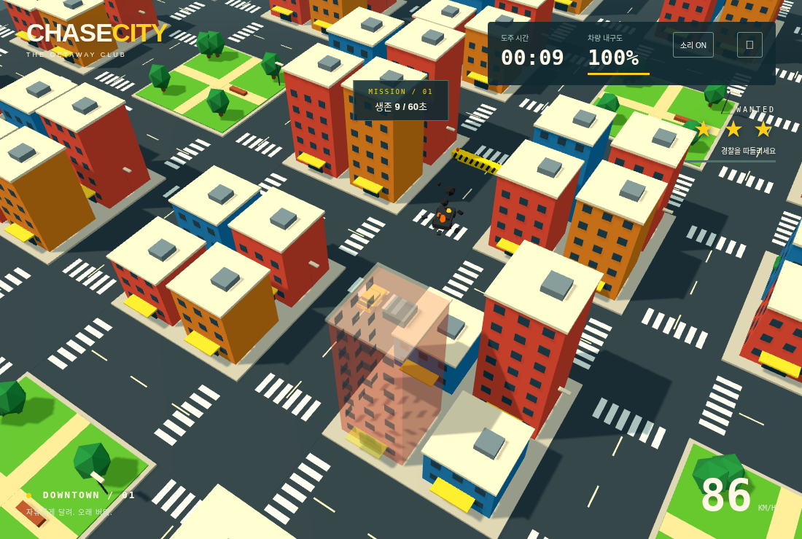
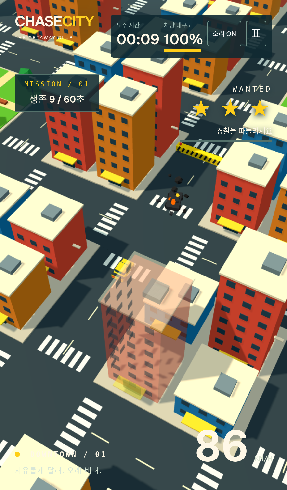
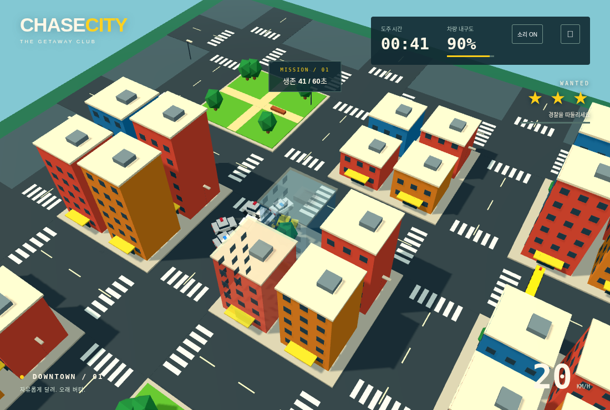
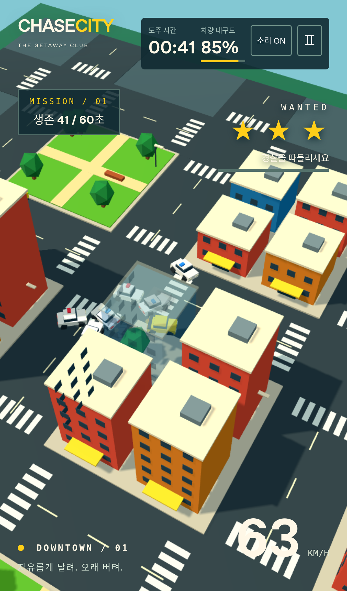

# CHASE CITY V1.5 검증

2026-11-11. 최신 V1.4 main (`066da4f`) 기반. 테스트 환경은 Node.js, PC Chromium, iPhone 13 크기/터치 WebKit 에뮬레이션이다.

## 자동 테스트

`npm test`: **61개 통과**. V1.4의 49개 회귀 검사와 V1.5의 12개 시나리오를 포함한다.

- 실제 4대 포위 AI/물리 시뮬레이션: 약 3초에 체포, 그 이전 실패 없음, 경찰 4대 내구도 모두 100, 폭발 0, 체포 후 시뮬레이션 정지.
- 3대·4대 경찰의 600프레임 저속 접촉 반복: 쿨다운을 강제로 해제하는 가혹한 fixture에서도 피해 0. 실제 고속 충돌은 2회에 내구도 0이며 기존 시뮬레이션 폭발 이벤트 검사도 유지한다.
- 네 방향 경찰이 있어도 충분한 공간이 있으면 체포 불가. 포위 경찰 하나가 빠져나가면 1.5초 이상 찼던 체포 게이지가 0.75초 안에 0으로 감소한다.
- 직선 출구가 없어도 곡선 통로가 있는 배치에서 체포를 방지하고, 경찰 증원은 잔해 우회용 보조 노드가 아닌 실제 도로에서만 생성한다.
- 포위 슬롯의 네 방향 분리와 접근 감속, 건물 반대편 A* 우회/방향 변경 재탐색, 반복 벽 돌진 방지.
- 10/20/30/40/50초 바리케이드와 2초 사전 경고. 도로 전체 차단 및 틈 제거, 18개 서로 다른 배치 상황의 우회로 전체 선분 검증. 각 배치에서 도로 폭의 다섯 횡방향 위치로 플레이어와 경찰 반경을 각각 이동시켜 실제 관통 불가를 확인한다.
- 플레이어 바리케이드 감속/피해 0, 경찰 강한 충격 피해, 차량 충돌에 밀려 장애물에 닿는 같은 프레임 피해, 동적 경로 무효화.
- 잔해의 착지 후 물리 장애물 등록, 경찰 재투입 후에도 잔해 유지, 잔해 뒤의 목적지 및 외곽 단일 탈출 도로에서 보조 노드를 통한 A* 우회.
- 잔해 개수 제한·화면 밖 우선 정리·화면 안 수명 종료 시 점진적 축소, 지속 화재/검은 연기/바닥 파편, 공유 재질·고정 풀·재시작 초기화.
- 기존 플레이어 속도/경찰 가속·증원, 부드러운 조향/건물 피해 0, 전체 건물 투명화/셰이더 복원, 후방 효과 풀, 사운드 폴백, 체포/파괴 수명주기.
- 60초 생존 후에도 진행, 바리케이드 해제, 12개 외곽 후보 도로 연결/게이트 통과, 실패 우선 처리, 최종 게이트 이전 성공 금지 및 500 크레딧 1회 지급.

## 구현상 확인한 원인과 수정

이전 체포 판정은 근처 경찰 수와 내부 속도만 검사했다. 충돌로 실제 위치가 막혀도 자동 전진 목표 속도가 남을 수 있고, 반대로 공간이 충분해도 게이지가 찰 수 있었다. 최종 위치의 실제 프레임 이동 속도를 사용하고, 차량 크기를 고려한 24방향 통로 검사 및 곡선 이동 공간 탐색으로 갇힘을 확인한다. 세 대 이상이 근접하고 실제 속도 3 미만이며 출구가 없을 때만 게이지가 증가한다.

저속 접촉에서는 위치 분리와 반발을 유지하되, 피해에는 충돌 전 최대 주행 속도·상대 속도·접촉 법선 접근 속도를 모두 요구한다. 포위 AI도 슬롯에 도착하면 감속해 정차하므로 저속 밀집을 사고 에너지로 취급하지 않는다. 고속 실제 충돌과 손상된 차량의 연쇄 폭발은 유지한다.

바리케이드는 전체 폭 메시/충돌체로 변경했다. 후보마다 새 바리케이드와 기존 장애물을 포함한 별도 도로 그래프를 만들고, 막힌 구간 양쪽을 잇는 다른 도로 경로가 있을 때만 배치한다. 통과 틈은 없다.

잔해는 원래 경찰 차량의 재투입 수명주기와 분리한다. 착지 시 장애물과 A*를 갱신하고, 잔해 주변 보조 노드로 우회한다. 활성 16개/최대 수명 30초, 화면 밖 18초 이상 우선 정리, 화면 안 물체는 1.5초에 걸쳐 축소한다. 최대 8대의 경찰 재투입 간격을 고려해 정리 중 잔해 8개를 포함한 고정 24개 렌더 풀을 사용한다. 재질과 지오메트리는 모든 슬롯이 공유한다.

## 브라우저 및 프로덕션

PC Chromium / iPhone 크기 WebKit에서 **26개 고유 시나리오의 최종 결과 모두 통과**했다. 전체 실행은 25개 통과했으며, Chromium의 체포→재시작→파괴 검사에서 두 번째 실패 UI의 5초 대기 한도를 초과했다. 별도 브라우저 재현에서는 정상 초기화/파괴 전환과 페이지 오류 없음을 확인했다. 새 실행의 첫 물리 프레임을 기다리고 실패 UI에 45초 한도를 적용하도록 fixture를 보강했다. 잔해 효과 fixture도 절대 게임 시각과 차체 애니메이션 나이를 일치시켰다.

이후 실제 도로에서만 증원하도록 우회 보조 노드를 제외하고, 잔해/연기 전체를 보호하는 보수적 카메라 가시 범위를 적용했다. 최종 코드에서 영향을 받는 추격·체포/파괴·지속 화재 시나리오 6개를 양쪽 브라우저에서 다시 실행해 모두 통과했다. 전체 결과: [docs/browser-validation-v1.5.json](docs/browser-validation-v1.5.json).

검증 내용:

- 실제 저속 4대 포위 후 BUSTED, 경찰 내구도 100/폭발 0, 실패 후 시간·주행 사운드 정지.
- RESTART 한 번으로 새 실행 시작, WRECKED와 실패 원인 구분, 정지/음소거·실제 Web Audio 출력·미지원 폴백.
- 8–9초가 지난 검게 탄 차체, 계속 움직이는 불꽃/검은 연기, 바닥 파편과 실제 장애물 등록, 고정 24개 풀 및 초기화.
- 노란 전체 도로 바리케이드 메시/양면 검정 사선과 경로 데이터, 생성 경고, 60초 이후 해제.
- 기존 키보드/실제 터치, 벽 슬라이딩, GPU 픽셀 기반 건물 투명화/복원, 후방 효과, 탈출 안내/게이트/500 크레딧 중복 방지.

실제 렌더러의 41초 추격 통합 표본에서도 활성 추격, 8대 차량/메시, 경로 재계산과 후방 효과를 검증했다. 정상 좌우 입력만 사용한 별도 표본이며 상세 값은 [docs/actual-camera-v1.5.json](docs/actual-camera-v1.5.json)에 기록한다. 기기 FPS 측정은 아니다.

`npm run build` 성공. 최종 프로덕션 preview에서도 START/타이머 진행/키보드 입력과 이동/음소거/일시정지/개발 hook 제외/페이지 오류 없음을 확인했다: [docs/production-smoke-v1.5.json](docs/production-smoke-v1.5.json).

## 실제 렌더링 화면

아래 화재 화면은 진단 fixture에서 폭발 후 9초의 잔해를 고정한 실제 GPU 렌더링이다. 성공률/성능 측정과 구분한다. 불꽃·검은 연기의 애니메이션 변화와 재시작 초기화는 별도 assertion으로 확인한다.

## 전체 미션 추가 주행

정상 좌우 입력만 사용하는 4시드 자동 주행 결과: 탈출 2회, 차량 파괴 2회. 위치·내구도 수정, 강제 폭발이나 강제 성공은 없다. 네 실행 모두 60초에 탈출 단계로 전환됐고, 두 성공은 71.05초/86.63초에 최종 게이트를 통과해 500 크레딧을 받았다. 두 실패에는 보상 0이다. 이는 자동 조향 시나리오의 결과이며 사람의 성공률이나 실기기 성능을 뜻하지 않는다.

원시 결과: [docs/escape-v1.5.json](docs/escape-v1.5.json). 과거 버전 측정은 파일 이름의 버전으로 구분해 보존한다.

## 범위

실제 iPhone 기기 FPS·발열·배터리·스피커 청취와 Cloudflare 실제 배포는 미실시다. 프로덕션 정적 빌드와 Pages 설정은 유지한다. 보상은 현재 실행의 크레딧이며 영구 지갑은 후속 확장 대상이다.
