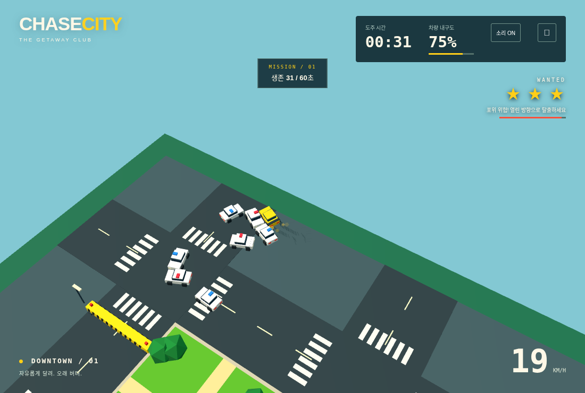
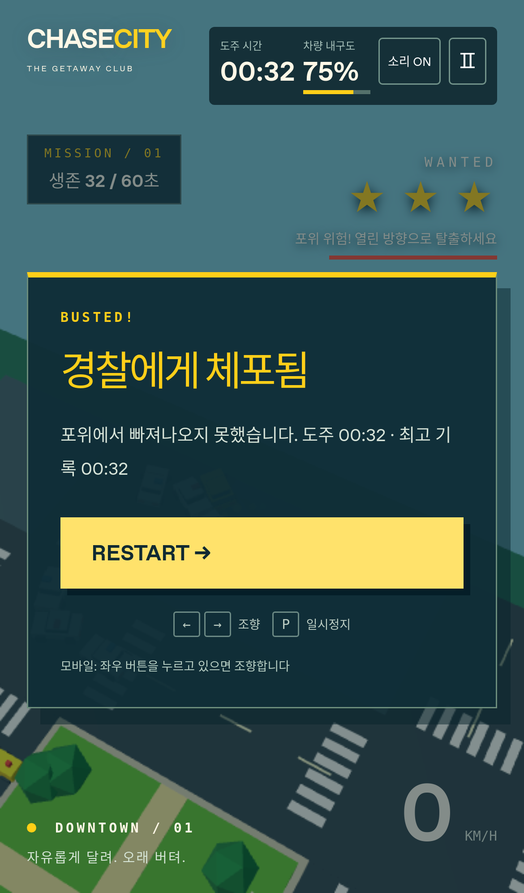
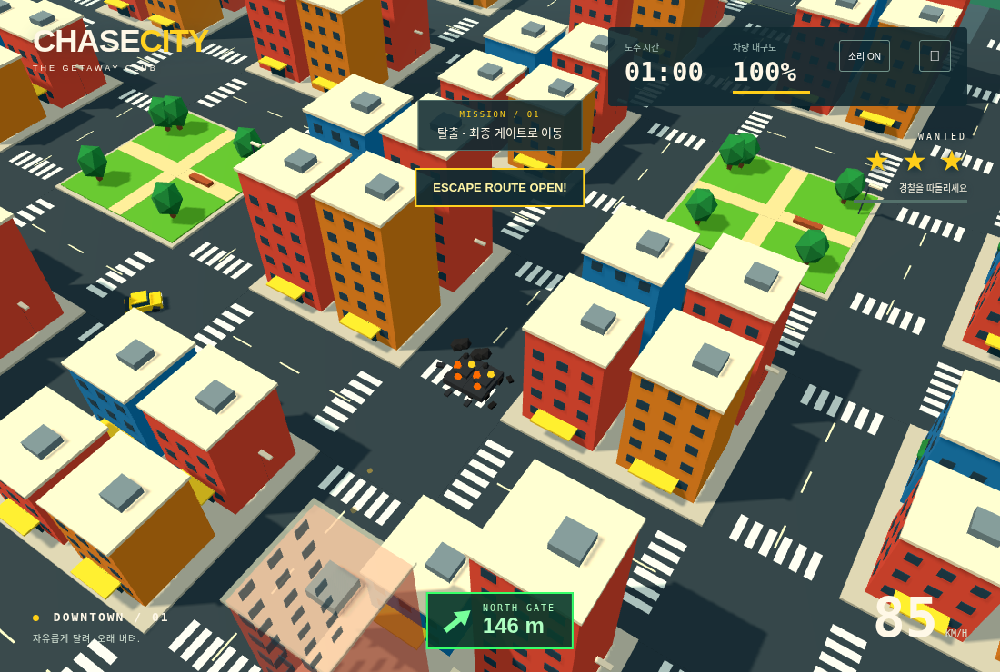

# CHASE CITY V1.6 재현 및 검증

2026-11-11. 최신 V1.5 main `f32b4f9` 기반. 새 게임 콘텐츠 없이 영구 잔해와 실제 체포 실패, 포위 중 자폭을 수정했다.

## V1.5 재현과 원인

기본 START 이후 경찰 위치·속도·내구도·증원·미션을 바꾸지 않고 60 Hz로 진행했다. 첫 경로는 직진 유지, 두 번째는 5초 직진 후 우회전 유지다.

- 직진 경로 약 33초: 경찰 3대, 기존 공간 검사 `trapped: true`, 실제 이동 속도 약 4.50, 체포 게이지 0. `groundSpeed < 3` 분기 때문에 포위망 안의 밀림도 탈출로 취급하고 있었다.
- 우회전 경로: 가까운 경찰 최대 4대였지만 60초 동안 체포 게이지 최대 0, BUSTED 없음. 기존 작은 원의 자유 이동 검사가 차체 전체와 조향이 통과할 수 없는 틈까지 출구로 인정할 수 있었다.
- 잔해는 `wreckLifetime: 30`, 화면 밖 18초 정리, 최대 16개 활성 잔해/렌더 슬롯의 교체로 사라졌다. 경찰 재투입과 별개로 데이터가 정리되는 경로가 있었다.

수정 전 원시 기록: [docs/normal-cordon-v1.5-reference.json](docs/normal-cordon-v1.5-reference.json). 이전 코드에서 수정 전에 수집한 고정 시뮬레이션 기록이며 브라우저 실기기 FPS 측정은 아니다.

## 수정 원칙

체포는 3대 이상이 가까이 있을 때 차체 전체의 전진·회전 공간을 검사한다. 양 끝뿐 아니라 이동/회전 중간 자세도 검사한다. 옆으로 미끄러지는 점이나 즉시 회전하는 원을 차량 경로로 사용하지 않는다. 초기 접촉을 더 파고들거나 다른 차량을 관통하는 경로도 배제한다. 실제 출구가 없으면 원시 월드 속도가 높아도 체포를 진행하며, 실제 출구가 열리거나 가까운 경찰이 줄면 빠르게 감소한다. 최종 체포 직전에도 공간을 다시 검사한다.

경찰은 포위 진입 시 가속을 종료하고 속도/접근 속도를 제한한다. 막힌 플레이어의 조향에 맞춰 포위 슬롯까지 계속 회전하지 않도록 대형 방향을 유지한다. 저속 경찰 접촉 피해 0과 고속 사고 피해를 구분한다. 가까운 저속 포위 차량의 폭발 연쇄 피해/충격은 줄이고 살아 있는 포위 차량을 즉사시키지 않는다. 이미 파괴된 차량을 되살리거나 일반 고속 사고/연쇄 폭발을 막지는 않는다.

잔해 데이터는 실행 전체에 걸쳐 누적된다. 위치·방향·ID·장애물은 카메라, 시간, 경찰 재투입, 렌더 슬롯 수와 독립적이다. 렌더 캐시는 화면에 처음 들어온 잔해에 할당하며 16개를 넘으면 확장한다. 화면 밖의 렌더 그룹은 장면에서 분리하지만 데이터/슬롯 객체는 유지한다. 복귀 시 같은 그룹을 다시 붙이고 현재 시각의 화재를 갱신한다. 먼 이펙트는 5–10 Hz로 갱신한다. 결과 화면에서는 게임 시각이 멈추므로 마지막 상태를 유지하고, RESTART에서만 데이터를 초기화한다.

## 정상 START → 실제 브라우저 AI 체포

`tests/browser/v16.spec.js`의 첫 시나리오는 **경찰 강제 배치와 시뮬레이션 수동 진행을 사용하지 않는다.**

1. 기본 브리핑/시작 위치와 초기 경찰 4대를 확인하고 START를 누른다.
2. 기본 게임의 requestAnimationFrame/고정 물리 루프를 그대로 실행한다. 5초 이후 정상 우회전 입력만 유지한다.
3. 경찰 배치, 내구도, 최고속도, 체포 게이지, 증원, 미션, 게임 시각은 수정하지 않는다.
4. 게이지 시작/중간/90% 구간에서 일반 일시정지 버튼으로 정지해 실제 화면을 캡처한 뒤 재개한다.
5. 실제 BUSTED 결과 화면, 게이지 100%, 사운드 정지와 경찰 폭발 0을 확인한다.

소프트웨어 GPU의 실행 시간을 줄이기 위해 진행 중 내부 캔버스 해상도를 낮추고 정적 그림자 갱신을 동결했다. 캡처는 1x 캔버스 해상도에서 실제 렌더링한다. 물리·AI·입력·게임 시간은 배속/강제 진행하지 않는다. 이 해상도 설정은 테스트에만 있으며 제품 기본 설정을 바꾸지 않는다.

Node 재현: `node scripts/reproduce-v16.js`. 원시 고정 시뮬레이션: [docs/normal-cordon-v1.6.json](docs/normal-cordon-v1.6.json). 브라우저의 시간별 게이지·월드 속도·포위망 상대 속도·근접 경찰·폭발 수는 별도 원시 기록으로 보존한다.

## 잔해 장시간·복귀·확장 검증

첫 정상 AI 시나리오와 별개인 **충돌/장시간 fixture**다. 위치를 정한 경찰 두 대에 실제 상대 속도 충돌을 두 번 적용해 내구도가 0이 된 뒤 폭발시킨다. 이후 실제 경찰 재투입을 확인하고, 장시간 잔해 확인은 경찰이 없는 fixture로 분리한다. 게임 시각을 대입하지 않고 `Simulation.update(1/60)`으로 1/30/60/61/62초를 진행한다. 이는 60초의 벽시계 대기를 뜻하지 않으며 고정 물리 시뮬레이션의 경과 시간이다.

- 최초 잔해의 같은 ID·좌표·객체 참조와 실제 장애물 등록을 확인한다.
- 30초와 60초에 차체·불꽃·검은 연기를 실제 렌더링하고 화면을 남긴다.
- 관찰 카메라를 다른 곳으로 옮겨 화면 밖 렌더 생략과 데이터 유지를 확인한다. 플레이어나 잔해를 옮기지 않는다.
- 복귀 시 같은 렌더 슬롯/위치와 계속 갱신되는 화재를 확인한다.
- 추가 폭발 fixture 40개로 기존 한도를 넘겨도 최초 잔해가 유지되고 캐시가 확장되는지 확인한다. 이 수치를 정상 게임의 자연 폭발 빈도로 보고하지 않는다.
- WRECKED 결과 상태에서 시각·잔해 수·연기 상태가 동결되고, RESTART 후 데이터/활성 캐시가 비워지는지 확인한다.

## 자동 테스트와 회귀 범위

기존 테스트 중 30초/화면 밖/개수 초과 정리를 기대하던 항목은 V1.6의 영구 유지 요구로 변경했다. 작은 원만 통과하던 틈도 차체 전체가 통과할 수 없는 경우에는 출구가 아니어야 한다는 기준으로 변경했다.

현재 검증에는 정상 시작 AI 체포, 저속 접촉 0 피해, 고속 두 번 충돌 파괴, 포위 차량의 연쇄 폭발 보호와 일반 연쇄 폭발, 실제 재투입 후 잔해 독립성, 한도 초과/거리/시간 경과와 복귀, 결과 정지/재시작, 충분한 출구에서 체포 방지/게이지 감소를 포함한다. 많은 자세를 탐색해야 하는 큰 닫힌 공간도 실제 경로를 찾지 못한 상태에서 출구로 취급하지 않는지 검사한다.

기존 A* 추격·증원·바리케이드 일정/전체 차단/우회, 플레이어 건물 피해 0과 조향, 건물 전체 투명화/픽셀 복원, 후방 효과, 실제 Web Audio 출력/정지/음소거/미지원, 60초 이후 탈출과 최종 게이트의 500 크레딧 1회 지급도 회귀 검사한다.

## 최종 결과와 증거 파일

- 자동 테스트 **68개 통과**.
- PC Chromium / 모바일 WebKit의 **30개 고유 시나리오 최종 통과**. 핵심 4개 최초 검사와 회귀 28개를 분할 실행했고, 최종 체포 탐색/재투입 검증을 포함한 영향 시나리오 6개를 다시 실행했다.
- 회귀 실행 중 이전 추격 입력은 WebKit에서 40.47초에 실제 BUSTED가 발생해 기존의 41초 생존 assertion을 만족하지 못했다. 체포 조건을 약화하지 않고, 추격 렌더링 전용 fixture는 다른 정상 회피 입력(시드 2)을 사용해 기존 41초/차량 수/화면 노출 assertion을 유지했다. 기본 START의 실제 체포 검증은 별도 유지한다.
- 큰 닫힌 포켓의 8,458개 자세를 검사하는 회귀도 추가했다. 탐색량 초과를 출구로 반환하지 않고 유한한 자세 공간의 탐색을 완료하며, 방향별 SAT 데이터를 미리 계산해 비용을 줄였다.
- 프로덕션 빌드 성공. 최종 preview에서 START/타이머/조향·이동/음소거/일시정지 및 개발 hook 제외를 확인했다.

| 실제 브라우저 항목 | Chromium | 모바일 WebKit |
| --- | ---: | ---: |
| BUSTED 게임 시각 | 32.13초 | 32.13초 |
| 완료 체포 게이지 | 3.00 / 3.00 (100%) | 3.00 / 3.00 (100%) |
| 정상 실행 전체 경찰 폭발 | 0 | 0 |
| 실제 경찰 재투입 후 최초 잔해 | 동일 객체, 1세대 재투입 | 동일 객체, 1세대 재투입 |
| 폭발 후 30초/60초 | 동일 ID·좌표·장애물·화재 | 동일 ID·좌표·장애물·화재 |
| 화면 밖 → 복귀 | 렌더 생략 → 같은 슬롯 재표시 | 렌더 생략 → 같은 슬롯 재표시 |
| 추가 폭발 후 데이터 / 렌더 슬롯 | 42 / 42 | 42 / 42 |
| 결과 화면 / RESTART | 동결 / 초기화 | 동결 / 초기화 |

최초 잔해 ID는 1, 좌표는 두 엔진 모두 `(-0.051, -8)`이다. 폭발 후 약 6.12초에는 두 경찰의 실제 재투입 세대 `[1, 1]`과 최초 잔해의 동일 객체 참조를 확인했다. 30.02초·60.02초·61.02초에도 같은 객체/좌표가 남고, 약 62.22초에 총 42개로 늘린 뒤에도 같은 렌더 슬롯을 사용한다. 기존 슬롯을 다른 잔해로 교체하지 않았다.

초기 접촉 이후 일시적으로 출구가 열리는 구간에서는 게이지가 감소한다. 최종 폐쇄 구간에서는 가까운 3–4대가 차단하고 약 3초에 체포된다. 원시 이동 속도가 3을 넘는 표본에서도 실제 출구가 없으면 게이지가 계속 증가한다.

원시 증거:

- [브라우저 전체 결과](docs/browser-validation-v1.6.json)
- [정상 START 실제 프레임 시간 기록](docs/actual-play-v1.6.json)
- [잔해 재투입·30/60초·복귀·확장·종료 기록](docs/wreck-persistence-v1.6.json)
- [실제 추격 카메라 회귀 표본](docs/actual-camera-v1.6.json)
- [프로덕션 실행 확인](docs/production-smoke-v1.6.json)

## 실제 렌더링 화면

| 단계 | Chromium | 모바일 WebKit |
| --- | --- | --- |
| 접촉/게이지 시작 | [화면](docs/screenshots/v1.6-desktop-chromium-contact.png) | [화면](docs/screenshots/v1.6-iphone-webkit-contact.png) |
| 게이지 약 50% | [화면](docs/screenshots/v1.6-desktop-chromium-arrest-50.png) | [화면](docs/screenshots/v1.6-iphone-webkit-arrest-50.png) |
| 게이지 약 90% | [화면](docs/screenshots/v1.6-desktop-chromium-arrest-90.png) | [화면](docs/screenshots/v1.6-iphone-webkit-arrest-90.png) |
| BUSTED 결과 | [화면](docs/screenshots/v1.6-desktop-chromium-busted.png) | [화면](docs/screenshots/v1.6-iphone-webkit-busted.png) |
| 폭발 후 30초 | [화면](docs/screenshots/v1.6-desktop-chromium-wreck-30.png) | [화면](docs/screenshots/v1.6-iphone-webkit-wreck-30.png) |
| 폭발 후 60초 | [화면](docs/screenshots/v1.6-desktop-chromium-wreck-60.png) | [화면](docs/screenshots/v1.6-iphone-webkit-wreck-60.png) |
| 카메라 밖 | [화면](docs/screenshots/v1.6-desktop-chromium-wreck-offscreen.png) | [화면](docs/screenshots/v1.6-iphone-webkit-wreck-offscreen.png) |
| 복귀 및 42개 확장 후 | [화면](docs/screenshots/v1.6-desktop-chromium-wreck-return-expanded.png) | [화면](docs/screenshots/v1.6-iphone-webkit-wreck-return-expanded.png) |

## 범위

PC Chromium 및 iPhone 크기/터치 WebKit 에뮬레이션 검증이다. 실제 iPhone 기기 FPS·발열·배터리·스피커 청취와 Cloudflare 실제 배포는 미실시다. 영구 잔해 데이터와 한 번 표시한 렌더 캐시는 실행 중 누적되며, 기존 잔해 삭제로 메모리를 제한하지 않는다.
