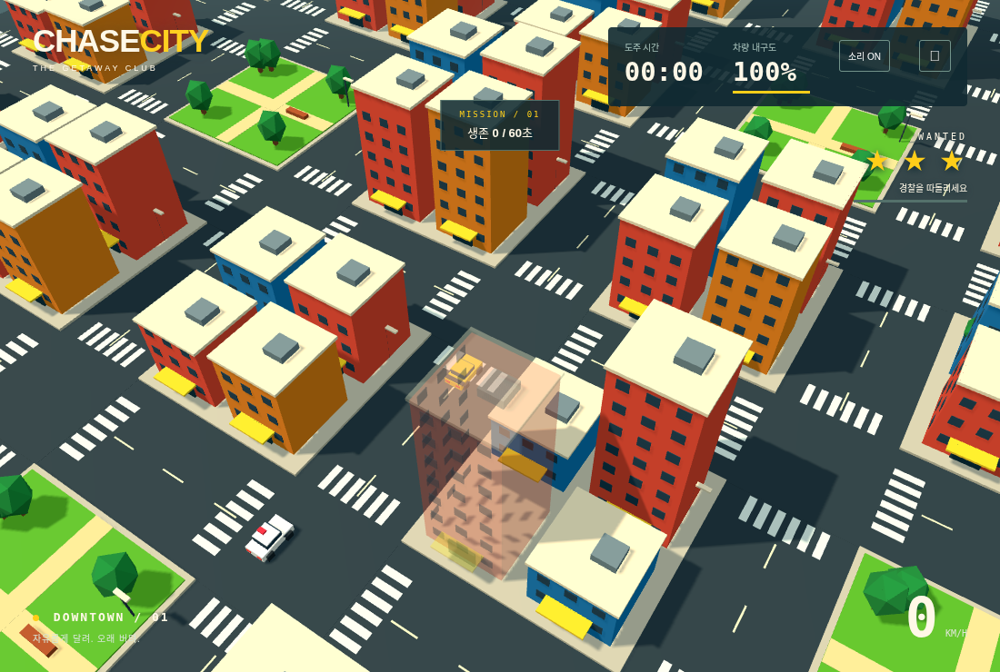
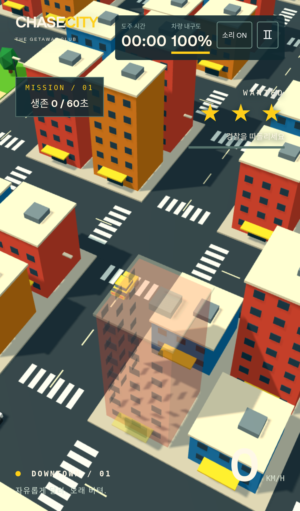

# CHASE CITY V1.2 검증 기록

2026-11-11. 플레이어 24 / 일반 경찰 20, 좌우 조향, 60초 생존 미션을 유지한다.

## 건물 투명화 원인 및 실제 렌더 검증

V1.1은 `MeshStandardMaterial.transparent`와 `opacity`를 바꿨지만 `needsUpdate`를 설정하지 않았다. Three.js의 기존 `OPAQUE` 셰이더는 출력 알파를 1로 강제한다. CPU 재질 속성만 검사하면 값은 0.35이므로 이 문제를 놓친다. 상태 전환 시 셰이더 버전을 갱신하고, 복원 시에도 불투명 셰이더로 전환한다.

건물은 본체·지붕·옥상 설비·창문·문·간판을 병합한 독립 지오메트리/재질이다. 실제 병합 지오메트리의 bounding box로 후보를 좁힌 뒤 카메라–차량의 회전된 차체 샘플까지 정확한 광선 검사를 한다. 충돌용 건물 객체는 별도로 유지한다. 깊이 쓰기는 투명 전환 중 끄고, 완전 불투명 복원 시 켠다.

브라우저 검증은 불투명 셰이더를 실제로 한 번 렌더한 다음 GPU 프레임버퍼를 읽는다. 차량을 표시/숨긴 두 프레임의 픽셀 차이로 차량이 화면에 기여하는 픽셀과 RGB 변화량을 계산한다.

1. 불투명 상태 기준값.
2. V1.1 방식의 음성 대조군: `needsUpdate` 없이 값만 변경하면 기준값과 동일함.
3. 수정된 경로: 가리는 건물이 35%로 전환된 후 차량 표시 픽셀과 RGB 변화량이 증가함.
4. 완전 복원 후 기준값과 동일함. 다른 건물 재질과 건물 충돌 배열 유지.

스크린샷도 직접 확인한다. 자동 검사 수치는 `docs/render-validation.json`, 화면은 `docs/screenshots/`에 보존한다.

## 충돌/폭발 밸런스 측정

재현 명령: `npm run test:balance`. `scripts/autoplay.js`는 혼합 시드 LCG로 루프 방향, 도로 범위와 코너 진입 시점을 선택한다. 좌우 입력만 생성하고 60 Hz 고정 간격으로 각 60초 주행한다. 경찰 4대는 정상 AI·충돌·내구도·폭발·재투입을 사용한다. 폭발 호출, 내구도 보정, 위치 이동, 무적은 사용하지 않는다. 정상 사망/체포 시 재시작하는 경우는 횟수를 기록한다.

최종 결과 (`docs/balance-v1.2.json`):

- 초기 40시드(1–40): 60초당 평균 **3.175대**.
- 별도 20시드(1001–1020): 평균 **2.85대**.
- 합계 60시드, 총 3,600초: **184대 / 60 = 3.0667대/60초**.
- 개별 범위 0–9대. 최종 측정의 정상 재시작 **0회**.
- 같은 초기 40개 입력 시드에서 V1.1 평균 **1.975대** (`docs/balance-v1.1-reference.json`).

횟수는 연쇄 폭발을 포함한 폭발 경찰 차량 수다. 사고 한 번에 여러 차량이 폭발할 수 있다. 평균 목표 2–4대를 만족하며, 모든 개별 시드나 사람의 운전 경로에서 같은 빈도를 보장하지 않는다. 타이머나 임의 폭발 발생기는 없으며, 충돌 접근 속도/충격 피해의 결과만 계수한다.

건물 및 실제 표시되는 공원 벤치를 고정 충돌체로 사용한다. 충격 법선 방향 속도 4 이하에는 피해가 없고, 벽/차량 충돌 종류별 0.8초 쿨다운을 적용한다. 폭발에는 더 밝은 화염, 중심 섬광, 충격파 링을 추가했다. 동적 광원 수 변경에 따른 셰이더 재컴파일을 피하도록 발광 재질을 사용한다.

## 사운드

`src/audio/sound.js`: 로컬 Web Audio 합성만 사용한다. 엔진 피치, 거리별 사이렌, 급회전/측면 미끄러짐에 따른 스키드, 충격별 충돌, 폭발, 성공/실패 UI 음. 외부 음원·샘플·유료 자산은 없다.

START 및 계속하기 사용자 동작에서 AudioContext를 생성/재개한다. 기본 ON, 음소거 버튼, master gain 0.45, 컴프레서(비율 12), 효과음 동시 6개 제한과 짧은 중복 제한을 둔다. 일시정지/포커스 상실/게임오버에서는 주행음을 끄고 예약 효과음을 정리한다. 게임오버의 결과음만 짧게 재생한다. Safari의 `webkitAudioContext`도 지원하고, 오디오가 없거나 초기화 실패해도 게임은 계속 작동한다.

브라우저에서는 실제 AudioContext가 START 전에 생성되지 않는지, 사용자 입력 후 running 상태인지, analyser의 PCM 에너지가 0이 아닌지, 음소거·일시정지 후 게인이 0으로 수렴하는지, 동시 효과음 수와 성공 음계 및 게임오버 후 정리, Web Audio 미지원 시의 게임 동작을 검사한다. 거리/속도/미끄러짐 제어 값은 별도의 자동 테스트로 검사한다.

## 회귀 및 실행

- `npm test`: 28개 자동 테스트 통과. 기존 건물 관통 방지, 내구도, 체포, 파괴, 미션 보상/리셋, 경찰 충돌·연쇄 폭발·재투입 및 새 쿨다운/건물·벤치 피해/셰이더 전환/오디오 폴백 포함.
- Playwright: PC Chromium, iPhone 13 크기의 WebKit에서 기존 3개 + V1.2 4개, 총 14개 시나리오 모두 통과. JSON 보고서는 `test-results/report.json`에 생성하며, 최종 요약은 `docs/browser-validation.json`에 보존했다. 초기 전체 실행의 PC 프레임버퍼/모바일 오디오 시간 초과 2건은 동일 게임 로직에서 재검사해 통과했다. 프레임버퍼 비교는 동일 그림자를 고정해 차량 표시만 분리했고, 320·375·390·844px HUD 버튼 경계 검사도 두 브라우저에서 통과했다.
- `npm run build`: 정적 `dist/` 생성 성공. 게임 코드와 Three.js 별도 청크, Cloudflare Pages 빌드 설정 유지.

이 환경의 WebKit 라이브러리는 작업 디렉터리에 설치하고 로컬 런처가 라이브러리 경로를 보존하도록 조정했다. 시스템 ldconfig 사전 검사 대신 실제 라이브러리 로딩/브라우저 실행을 확인했으며, 환경 전용 수정은 저장소에 포함하지 않았다.

프로덕션 preview 스모크 검사도 통과했다: 미션 START, 타이머 진행, 음소거 상태 변경, 일시정지, 드리프트 버튼 없음, 개발 진단 hook 제외, 페이지 오류 없음.

실제 iPhone 기기, 스피커/이어폰 청취 품질, 기기별 발열/배터리 및 프레임 성능은 검증하지 않았다. Cloudflare Pages 실제 배포는 수행하지 않았다.

## 실제 화면

