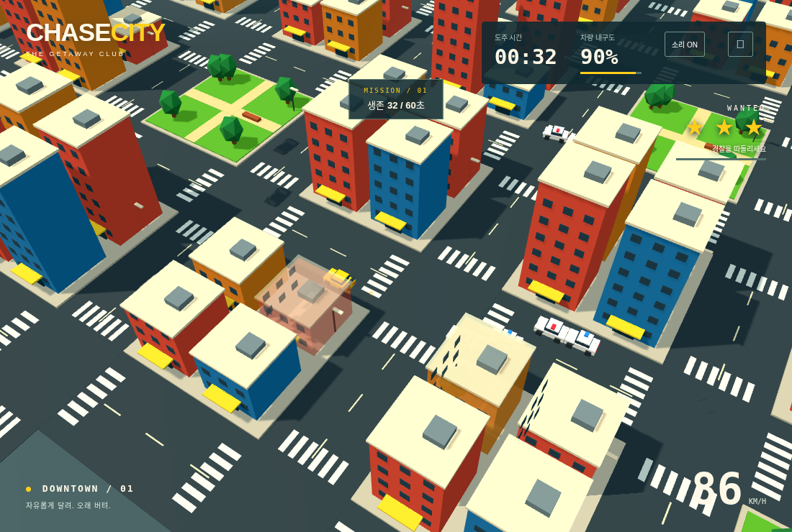
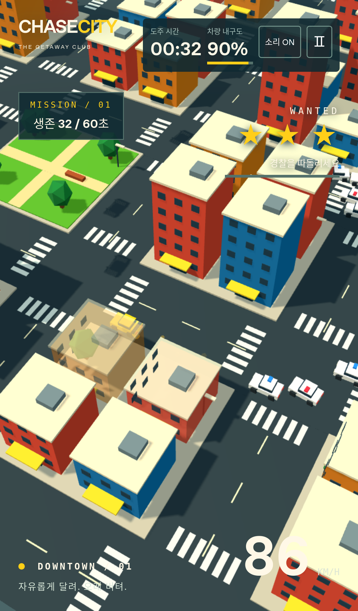

# CHASE CITY V1.3 검증

2026-11-11. 최신 V1.2(52d53bb) 기반.

## 자동 테스트

`npm test`: 36개 통과. 도로 A*의 모든 연결 선분, 건물 반대편 플레이어 우회/방향 변경 재탐색, 반복 벽 돌진 방지, 부드러운 조향/반전, 벽 미끄러짐 및 플레이어 건물 피해 0, 4→8대 제한/도로 증원, 차량 충돌 피해·연쇄 폭발·재투입, 미션·체포·파괴·투명 셰이더 전환·오디오 폴백 회귀, 먼지/자국 고정 풀과 리셋/정지, 공유 카메라 가림을 검사했다.

건물 접촉 테스트는 단순히 차량이 벽 앞에서 정지하는지를 확인하지 않고, 건물 내부에 들어가지 않으면서 접선 방향으로 이동해 빠져나오는지 확인한다. 경찰 충돌에서는 피해 기준과 쿨다운을 유지하고 플레이어 경찰 충돌 피해만 5/1초로 완화했다.

## 60초 반복 측정

각 12시드의 도로 주행과 급회전/유인 주행, 총 24×60초. 정상 좌우 입력만 사용하고 내구도/위치 보정이나 강제 폭발이 없다. 정상 체포/게임오버 시 재시작하며 횟수를 각 실행에 기록했다. 도로 주행 재시작 0회, 유인 주행 합계 6회다. 따라서 유인 결과는 재시작을 포함한 실제 플레이 시간 60초당 값이다.

| 지표                               | V1.2 도로 | V1.3 도로 | V1.3 유인 |
| ---------------------------------- | --------: | --------: | --------: |
| 최근접 경찰 평균 거리              |     46.18 |     20.03 |     20.51 |
| 모든 활성 경찰 평균 거리           |         — |     35.37 |     22.53 |
| 최근접 경찰 35 이내 추격 시간/60초 |   25.62초 |   56.82초 |   56.18초 |
| PC 화면 경찰 노출 비율             |     52.9% |     94.4% |     86.9% |
| 모바일 화면 경찰 노출 비율         |     33.2% |     77.8% |     81.6% |
| 전체 폭발/60초                     |      2.75 |         0 |      7.17 |
| PC 카메라에 잡힌 폭발/60초         |         — |         0 |      5.83 |
| 모바일 카메라에 잡힌 폭발/60초     |         — |         0 |      5.58 |
| 경찰의 의미 있는 벽 충격/60초      |     39.08 |      0.08 |      2.75 |

유인 시나리오 폭발 86대의 원인은 **차량 충돌 15대, 연쇄 71대, 벽 0대**였다. 도로 주행 중 폭발이 없다고 강제로 발생시키지 않는다. 유인/급회전에서 발생하는 실제 차량 사고를 보존하는 것이 의도다. 벽 충격은 피해 기준을 넘은 실제 충격이며, 차량 충돌로 밀리는 등의 접촉도 포함한다. 벽 충격이 모든 접촉을 의미하지는 않는다.

위 비교는 V1.3 전체 변경(경로 탐색, 증원, 조작)을 포함한다. V1.2도 같은 V1.3 카메라 정의를 사용해 카메라 조건을 통제했다. PC 프로필은 기존과 같고, 모바일 프로필은 V1.3의 넓은 시야다.

화면 노출은 단순 거리 기준이 아니라 공유 PerspectiveCamera의 투영과 건물 시선 가림 기준으로 5 Hz 측정한다. 플레이어를 가리는 반투명 건물은 투과 가능한 것으로 본다. Node는 건물 AABB, 실제 브라우저는 병합 지오메트리 광선 교차와 현재 opacity를 사용한다. 이는 객체 중심의 가시성 지표이며 픽셀 전체의 가시 면적/큰 연기까지 모두 계수하는 지표는 아니다.

원시 데이터: `docs/pursuit-v1.3.json`, 비교: `docs/pursuit-v1.2-reference.json`.

## 브라우저/렌더링

브라우저 고유 시나리오 18개가 PC Chromium/iPhone 크기 WebKit에서 모두 통과했다 (`docs/browser-validation-v1.3.json`). PC Chromium과 iPhone 크기의 WebKit에서 기존 미션·조작·일시정지·게임오버·리셋, GPU 픽셀 기반 건물 투명화/복원, 실제 Web Audio 출력/음소거/미지원, HUD 경계 회귀를 실행한다. V1.3에서는 실제 렌더러의 A* 추격/8대 메시/카메라 표본/후방 효과와 벽 슬라이딩·키보드/터치 조향을 추가 검증한다.

화면 이펙트는 먼지 48개 + 스키드 64개 고정 풀이다. 테스트에서 1,200회 갱신해 추가 메시가 증가하지 않음을 확인했다. 일시정지 중 수명이 진행되지 않고 재시작 시 모두 초기화한다. 주행 속도와 회전/미끄러짐을 스키드/엔진 소리와 함께 사용한다.

WebKit 의존 라이브러리는 환경 작업 디렉터리에 설치한 것을 사용한다. 로컬 런처의 라이브러리 경로 보존 및 시스템 ldconfig 검사 생략은 환경 전용으로, 저장소에는 포함하지 않았다.

실제 렌더러의 32초 통합 표본(도로 시드 7)도 별도 기록했다 (`docs/actual-camera-v1.3.json`). 최근접 평균 거리 약 18.55, 추격 31.6초/32초, PC 경찰 노출 30.4초/32초(95%), 모바일 20.4초/32초(63.75%)였다. 도로 노드 검색 484회, 경찰 8대/차량 메시 8개, 후방 먼지/스키드 표시와 고정 풀을 확인했다. 이는 60초 다중 시드의 Node 측정과 다른 단일/부분 구간 표본이며, 렌더링 빈도를 줄인 통합 검사이므로 기기 FPS 측정은 아니다.

최종 24시드 재현에서 추격 거리/유지 시간/PC·모바일 노출/벽 회피/유인 중 보이는 사고의 품질 기준이 모두 통과했다. `npm run test:pursuit`는 기준을 벗어나면 실패 코드로 종료한다. 증원할 수 있는 가까운 빈 도로가 없으면 먼 반대편으로 임의 배치하지 않고 다음 기회를 기다린다.

`npm run build` 및 프로덕션 preview 스모크 검사 통과: START, 타이머 진행, 조향, 음소거, 일시정지, 개발 hook 제외와 페이지 오류 없음.

## 실제 화면

## 범위

실제 iPhone 기기 프레임 성능·발열·배터리·스피커 청취 및 Cloudflare 실제 배포는 미실시다. 정적 빌드 구조와 배포 설정은 유지한다.
