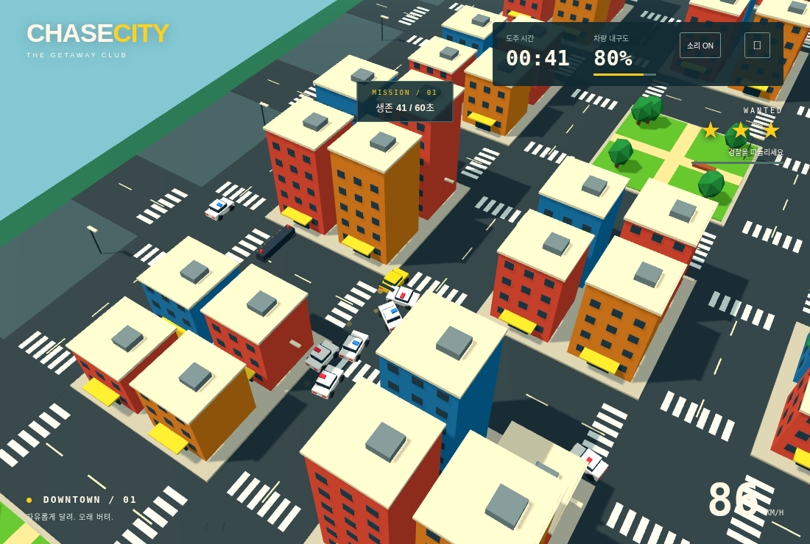
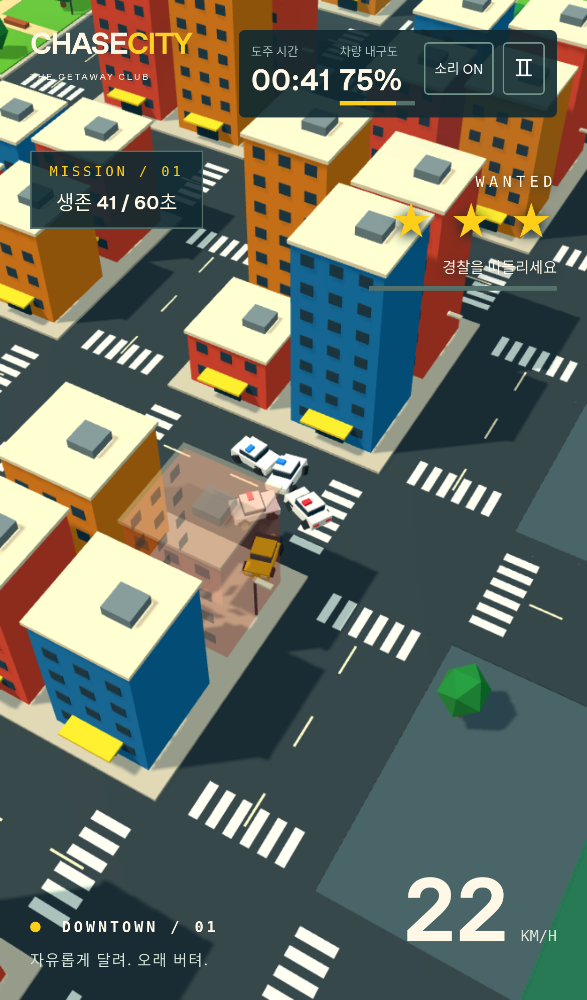
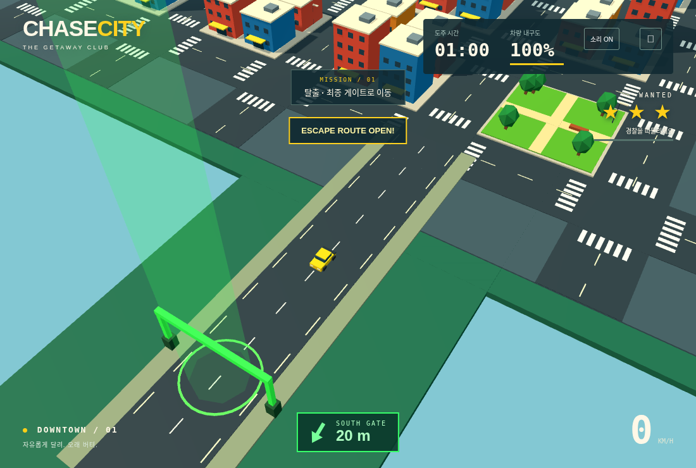
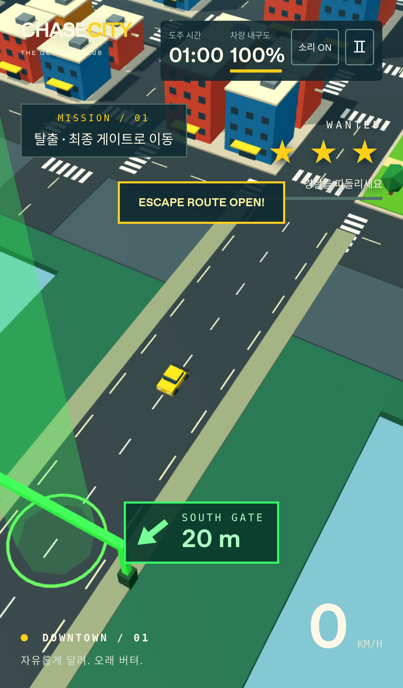

# CHASE CITY V1.4 검증

2026-11-11. GitHub main의 V1.3 (`9ac68ee`) 기반. 검증 환경: Node.js, PC Chromium 및 iPhone 13 크기/터치의 WebKit 에뮬레이션. 최종 수치와 원시 데이터는 아래에 기록한다.

## 자동 테스트

`npm test`: **49개 통과**.

- 플레이어 24 / 일반 경찰 22, 조건부 후방 가속으로 직선 격차 감소 및 코너 진입 시 가속 종료.
- A* 건물 우회/방향 변경 재탐색, 동적 바리케이드 경로 무효화, 외곽 도로까지 경찰 추격, 벽 반복 돌진 방지.
- 차량 차체 SAT 분리/충격, 실제 시뮬레이션에서 두 번의 강한 경찰 충돌 후 폭발, 장애물/바리케이드 피해, 차량 충돌에 밀려 바리케이드에 닿는 같은 프레임의 피해.
- 속도별 피해와 쿨다운, 가벼운 반복 접촉 보호, 손상된 이웃 차량의 연쇄 폭발, 잔해/재투입.
- 8/18/28/38/48초 경고와 10/20/30/40/50초 생성, 건물·장애물·차량과 겹치지 않는 배치, 폭 5의 실제 통과 틈, 우회 경로 및 제거 후 탐색 갱신.
- 4/5/6/7/8대 증원 일정과 최대 8대, 가까운 안전한 도로가 없을 때 무리한 원거리 배치 방지.
- 60초에 성공/보상 없이 탈출 단계 진입, 경찰/타이머 계속 진행, 바리케이드 해제, 12개 후보 모두 도로 연결 및 실제 물리 게이트 통과 성공, 재시작 시 새 후보.
- 게이트 이전/반대 방향/잠긴 단계 성공 방지, 체포·파괴 실패 우선, 탈출 후 보상 500 한 번만 지급 및 시뮬레이션 정지.
- 플레이어 건물 피해 0/벽 슬라이딩, 둥근 모서리에 갇히지 않는 접선 이동, 키보드/터치 입력, 미션/체포/파괴 수명주기.
- 기존 건물 전체 투명화/셰이더 복원, 오디오 폴백, 후방 먼지 48/자국 64의 고정 풀·리셋·정지 회귀.

충돌 오류 원인: 기존 짧은 중심 원형 판정이 보이는 차체 앞뒤의 충돌을 놓쳤고, 차량끼리 밀려 장애물에 닿을 때 위치 보정만 하던 경로에 내구도 처리가 빠져 있었다. 차체 크기의 회전 직사각형 접촉과 공통 장애물 피해 경로로 수정했다. 피해는 실제 접근 속도에서 계산하며, 시각적 차체 회전 자체를 추가 충돌 에너지로 계산하지 않는다. 한 번의 직접 충돌 피해는 최대 60으로 제한한다.

정면 벽/모서리에서는 실제 원형 충돌 형상으로 짧은 접선 경로를 검사해 이동한다. 경로 탐색용 보수적 AABB만 사용하면 둥근 모서리의 유효한 탈출 방향까지 차단하는 문제가 있어 해당 회귀를 추가했다. 플레이어를 다른 위치로 순간이동시키지 않는다.

## 측정 방식

일반 도로 주행 12시드와 급회전/유인 주행 12시드를 각각 60초, 고정 60 Hz로 실행한다. 공개된 도로/바리케이드 틈을 보고 정상 좌우 입력만 사용한다. 내구도/위치 조작, 무적, 강제 폭발은 없다. 실패 시 정상 재시작하며 횟수를 원시 데이터에 기록한다. 따라서 측정은 실제 플레이 시간 60초당 값이다.

화면 노출은 렌더러와 공유하는 PerspectiveCamera 투영 및 건물 시선 가림 기준으로 5 Hz 측정한다. 폭발은 발생 시점의 카메라로 검사한다. 플레이어를 가리는 반투명 건물은 투과 가능한 것으로 처리한다. Node 측정은 건물 AABB, 브라우저는 실제 병합 건물 지오메트리 광선 교차와 현재 opacity를 사용한다. 객체 중심의 가시성 지표이며 픽셀 전체의 면적/연기 전체의 노출을 계수하지 않는다. 최근접 경찰이 없는 표본은 거리 220으로 포함한다.

전체 탈출 검사는 별도 12시드, 재시작 없이 최대 180초까지 실행한다. 60초에 탈출구가 열리고 실제 조향으로 최종 게이트를 넘어야 성공으로 집계한다. 경계/보상/체포 등 개별 규칙을 검사하는 단위·브라우저 fixture는 측정 자동 주행과 구분한다.

## 60초 측정 결과

| 지표 | 일반 도로 (12시드) | 급회전/유인 (12시드) |
| --- | ---: | ---: |
| 최근접 경찰 평균 거리 | 19.29 | 18.88 |
| 모든 활성 경찰 평균 거리 | 26.47 | 26.69 |
| 최근접 경찰 35 이내 추격 시간/60초 | 57.42초 | 56.63초 |
| PC 경찰 화면 노출 | 92.6% | 90.5% |
| 모바일 경찰 화면 노출 | 90.6% | 89.1% |
| 전체 폭발/60초 | 9.17 | 16.58 |
| PC 화면 내 폭발/60초 | 7.67 | 13.92 |
| 모바일 화면 내 폭발/60초 | 7.17 | 14.17 |
| 피해가 발생한 경찰 벽 충격/60초 | 0.08 | 0.67 |
| 정상 실패/재시작 합계 | 0 | 0 |

일반 주행 폭발 110대: 차량 충돌 31, 연쇄 79. 급회전 주행 폭발 199대: 차량 충돌 51, 연쇄 148. 두 모드 모두 벽·바리케이드·원인 미상 폭발은 0이다. 바리케이드 충돌 피해/폭발 가능성은 별도 실제 물리 접촉 fixture로 검증하며, 경로 탐색으로 피할 수 있는 장애물에 일부러 충돌시키지 않는다. 폭발은 차량 단위로 집계하므로 한 번의 연쇄 사고에 여러 대가 포함된다.

각 실행의 10/20/30/40/50초 예정 이벤트 **120/120 생성 성공**, 안전 배치 실패 0. 위치·실제 발생 시간·가속 시간·충돌 원인·실패 횟수 등 원시 데이터: [`docs/pursuit-v1.4.json`](docs/pursuit-v1.4.json). 추격 거리·유지 시간·화면 노출·벽 회피·보이는 자연 사고의 여섯 품질 기준 모두 통과했다. `npm run test:pursuit`는 품질 기준 실패 시 실패 코드로 종료한다.

## 전체 탈출 자동 주행

12시드 중 **12/12 정상 탈출**. 성공 시각 64.87–76.40초, 평균 69.69초. 모든 성공의 탈출구 개방은 60초였고 최종 게이트 통과 후에만 500 크레딧을 받았다. 각 실행에서 위치/내구도/경찰 수를 수정하지 않았고 재시작하지 않았다. 이는 자동 조향 시나리오의 결과이며 사람의 성공률이나 실기기 성능을 의미하지 않는다.

원시 데이터: [`docs/escape-v1.4.json`](docs/escape-v1.4.json).

## 브라우저 및 프로덕션

PC Chromium / iPhone 크기 WebKit에서 **22개 고유 시나리오의 최종 결과 모두 통과**. 전체 실행은 21개 통과, Chromium 추격 검사의 기능 assertion 이후 스크린샷 저장 1건이 소프트웨어 GPU에서 60초 제한을 초과했다. 캡처 제한을 120초로 늘리고 실제 시뮬레이션이 41초 진행/실패 없이 유지됐다는 검사를 보강해 양쪽 추격 시나리오를 재실행했으며 2개 모두 통과했다. 이 최종 실행들 사이 게임 코드는 변경하지 않았다. 결과: [`docs/browser-validation-v1.4.json`](docs/browser-validation-v1.4.json).

검증 범위: START 전 정지, 키보드와 실제 터치, 회전/취소·일시정지·재시작·파괴, 화면 픽셀 기반 건물 전체 투명화/복원, 실제 Web Audio PCM 출력과 음소거·볼륨 제한·정지·미지원 폴백, 도로 통제 경고/실제 메시/탐색, 60초 이후 지속과 외곽 녹색 게이트/빛 기둥, 방향·거리 UI의 화면 내 배치, 최종 성공과 중복 보상 방지.

실제 렌더러의 41초 통합 추격 표본은 양쪽 브라우저에서 8대 메시/경로 검색/고정 후방 효과 풀과 카메라 노출을 확인했다. 원시 값: [`docs/actual-camera-v1.4.json`](docs/actual-camera-v1.4.json). 60초 다중 시드 측정과 별도의 부분 구간 표본이며 기기 FPS 측정은 아니다.

`npm run build` 성공. 프로덕션 preview에서 START/타이머/키보드 입력/이동/음소거/일시정지와 개발 hook 제외를 확인했다. 결과: [`docs/production-smoke-v1.4.json`](docs/production-smoke-v1.4.json).

## 실제 렌더링 화면

## 환경 및 범위

WebKit 실행 의존 라이브러리와 런처 경로는 환경 작업 디렉터리에 설치했으며 저장소에 포함하지 않았다. 실제 iPhone 기기 FPS·발열·배터리·스피커 청취 및 Cloudflare 계정의 실제 배포는 미실시다. 정적 빌드/Pages 설정은 유지한다. 보상은 현재 실행의 크레딧이며 영구 지갑은 후속 확장 대상이다.
